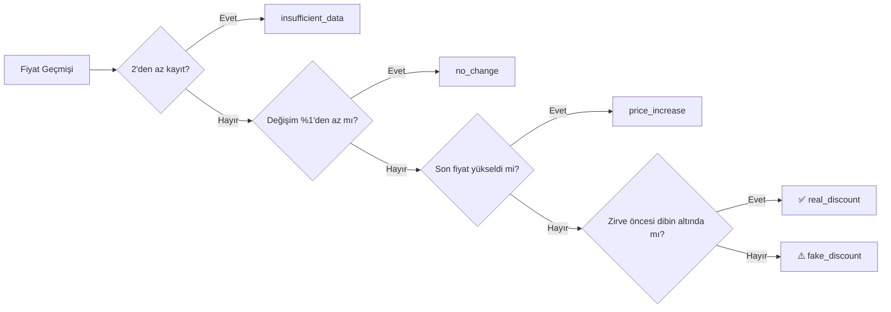
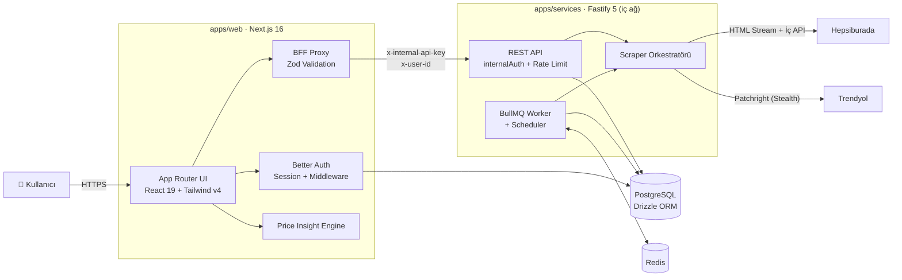
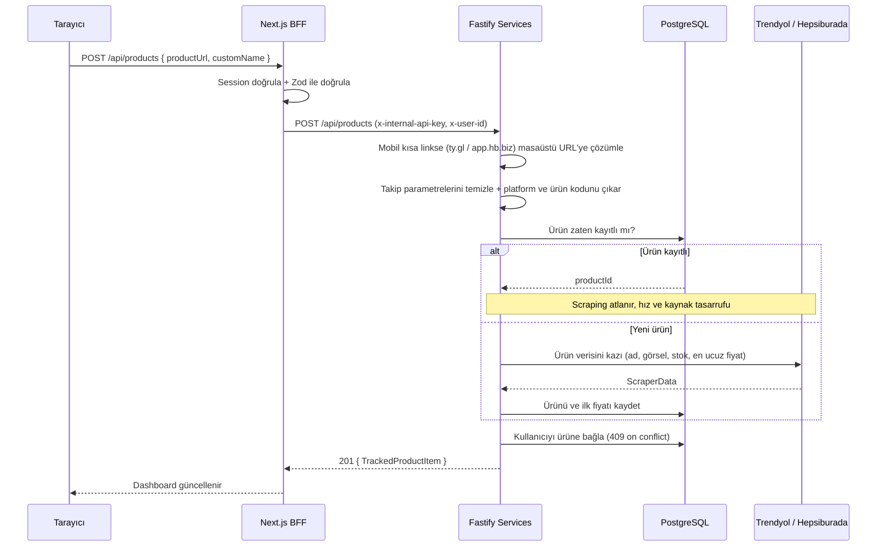
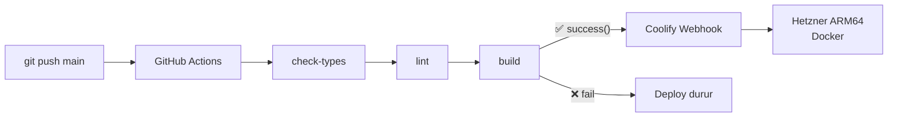

<div align="center">


# Karma

### İndirim gerçek mi, yoksa öncesinde zam mı yapıldı?

**Trendyol ve Hepsiburada ürünlerini tek bir panelden takip edin; fiyat geçmişini görün, sahte indirimleri yakalayın.**

<a href="https://karmatakip.com"><strong>🌐 Canlı Demo: karmatakip.com</strong></a>
&nbsp;·&nbsp;
<a href="#-özellikler">Özellikler</a>
&nbsp;·&nbsp;
<a href="#-sistem-mimarisi">Mimari</a>
&nbsp;·&nbsp;
<a href="#-mühendislik-detayları">Mühendislik</a>
&nbsp;·&nbsp;
<a href="#-yerel-kurulum">Kurulum</a>

<br />

[](https://github.com/borayrdmc/Karma/actions/workflows/ci.yml)


<br />


</div>

---

## 💡 Neden Karma?

Türkiye'deki e-ticaret kampanyalarında sık görülen bir durum var: Ürünün fiyatı kampanyadan birkaç gün önce **yükseltiliyor**, sonra "%30 indirim" etiketiyle **eski fiyatına ya da biraz altına** geri çekiliyor. Bu indirimlerin gerçek olup olmadığını anlamak için ürünün fiyat geçmişini bilmek gerekiyor.

**Karma** tam olarak bu işi yapıyor:

1. 🔗 Ürün linkini yapıştırın (Trendyol veya Hepsiburada — masaüstü ya da `ty.gl` / `app.hb.biz` mobil paylaşım linkleri).
2. ⏱️ Karma fiyatı ve stok durumunu **her 4 saatte bir** arka planda otomatik kontrol eder.
3. 📈 Fiyat geçmişi grafikle gösterilir; dip ve zirve noktaları işaretlenir.
4. 🧠 **Price Insight** motoru, indirimin **gerçek mi sahte mi** olduğunu söyler.

<br />


---

## ✨ Özellikler

<table>
  <tr>
    <td width="50%" valign="top">
      <h3>🔗 Tek Tıkla Ürün Takibi</h3>
      <p>Masaüstü veya mobil uygulama paylaşım linkini (<code>ty.gl</code>, <code>app.hb.biz</code>) yapıştırın, isterseniz <em>"Anneme alacağım kahve makinesi"</em> gibi kendinize özel bir isim verin. Platform ve ürün kodu URL'den otomatik çıkarılır.</p>
      
    </td>
    <td width="50%" valign="top">
      <h3>📈 Fiyat Geçmişi ve Analiz</h3>
      <p>Her ürün için güncel fiyat, en düşük (dip) ve en yüksek (zirve) değerler ile etkileşimli fiyat değişim grafiği.</p>
      
    </td>
  </tr>
</table>

| | Özellik | Açıklama |
|:-:|---|---|
| 🛒 | **Platformlar Arası Ortak Liste** | Trendyol ve Hepsiburada ürünleri tek panelde; platforma göre filtreleme |
| 📱 | **Mobil Kısa Link Desteği** | `ty.gl` ve `app.hb.biz` mobil uygulama paylaşım linklerini otomatik çözümleme |
| 🧠 | **Sahte İndirim Tespiti** | 30 günlük hareketli pencereyle gerçek ve sahte indirim ayrımı |
| 🏷️ | **İndirim / Zam ve Stok Takibi** | Her kartta son fiyat değişimi (₺), ne kadar önce değiştiği ve anlık stok durumu |
| ⏰ | **Otomatik Güncelleme** | BullMQ cron job'ları ile 4 saatte bir arka planda fiyat ve stok kontrolü |
| 🔐 | **Güvenli Hesap Sistemi** | Better Auth ile e-posta/şifre girişi, oturum yönetimi ve e-postayla şifre sıfırlama |
| 🎨 | **Özenli Arayüz** | Koyu tema, GSAP animasyonları, boş/hata/404 durumları için özel illüstrasyonlar |

<div align="center">
  
  &nbsp;&nbsp;&nbsp;
  
  &nbsp;&nbsp;&nbsp;
  
  <br />
  <sub>Boş durum, hata ve 404 sayfaları için özel illüstrasyonlar</sub>
</div>

---

## 🧠 Price Insight: Sahte İndirim Tespit Motoru

Projenin temel algoritması. Son **30 günlük** fiyat hareketine ve pencereden önceki son referans fiyata bakarak bir indirimin gerçekten "indirim" olup olmadığına karar verir. %1'in altındaki dalgalanmalar gürültü olarak değerlendirilir.



| Durum | Anlamı |
|---|---|
| ✅ `real_discount` | Fiyat, zirveden önceki dip seviyesinin **altına** indi. Gerçek bir fırsat. |
| ⚠️ `fake_discount` | Fiyat zirveden düştü ama hâlâ **zirve öncesi dibin üzerinde**. Önce zam, sonra indirim. |
| 📈 `price_increase` | Fiyat yükseldi; dip noktaya göre artış tutarı ve yüzdesi hesaplanır. |
| ➖ `no_change` | Fiyat sabit ya da değişim %1 eşiğinin altında. |
| ⏳ `insufficient_data` | Analiz için en az 2 fiyat kaydı gerekir. |

---

## 🏗 Sistem Mimarisi

Karma, sorumlulukları birbirinden ayrılmış bir **pnpm + Turborepo monorepo** olarak tasarlandı. Kullanıcıya dönük web katmanı ile kazıma (scraping) yapan worker sunucusu **tamamen ayrı süreçlerde** çalışır. Worker dış dünyaya kapalıdır ve sadece web uygulamasının BFF katmanı üzerinden erişilebilir.



### 📦 Monorepo Yapısı

```
Karma/
├── apps/
│   ├── web/                # Next.js 16: UI, Better Auth, BFF Proxy, Price Insight
│   └── services/           # Fastify 5: REST API, Scraper'lar, BullMQ Queue/Worker
└── packages/
    ├── db/                 # Drizzle şemaları (Auth + Product), migration'lar, modüler sorgular
    ├── errors/             # Merkezi ServiceError sınıfı (statusCode + isFatal bayrağı)
    ├── types/              # Uçtan uca paylaşılan TypeScript tipleri
    ├── validations/        # Ortak Zod şemaları
    ├── utils/              # Platform bağımsız yardımcılar
    ├── eslint-config/      # Paylaşılan ESLint preset'leri
    └── typescript-config/  # Paylaşılan tsconfig preset'leri
```

### 🔄 Ürün Ekleme Akışı (Smart Tracking)



---

## 🔬 Mühendislik Detayları

### 🕷️ Kazıma Mimarisi, WAF Atlatma ve Mobil Link Çözümleme

| Bileşen | Strateji |
|---|---|
| **Hepsiburada** | İlk eklemede HTML akışından ürün adı, görseli ve ürün kodu alınır; fiyat için dokümante edilmemiş iç listing API'si (`api/v1/product/listings/<code>`) sorgulanarak tüm satıcılar arasından **en ucuz listing** seçilir. Hem standart (`-p-`) hem de pazar yeri (`-pm-`) linkleri desteklenir: URL'deki kod `HBCV`/`HBV` ile başlıyorsa doğrudan kullanılır; üst ürün koduysa HTML içindeki `<meta name="page_value">` etiketinden varyant koduna düşülür (fallback). 4 saatlik rutin fiyat güncellemelerinde ise HTML hiç çekilmez; kayıtlı ürün koduyla doğrudan JSON API'ye gidilir. |
| **Trendyol** | WAF ve bot korumasını aşmak için doğrudan **`patchright`** (otomasyon izlerini gizleyen stealth Playwright/Chromium fork'u; `--headless=new`, `tr-TR` yerel ayarları ve `Sec-Fetch-*` başlıkları) kullanılır. Sayfa kaynağındaki `window["__envoy__SHARED_PROPS"]` nesnesi ayrıştırılarak ürün bilgileri, stok durumu ve kazanan satıcının (`winnerVariant`) fiyatı çıkarılır. |
| **Mobil Kısa Linkler (`resolveLinkFormat`)** | Mobil uygulamalardan paylaşılan `ty.gl` (Trendyol) ve `app.hb.biz` (Hepsiburada) kısa linkleri doğrudan desteklenir. SSRF ve açık yönlendirme (open redirect) risklerine karşı yönlendirmeler otomatik takip edilmez; `redirect: "manual"` ile adım adım (en fazla 5 hop) izlenir ve her ara durak izin verilen domain listesine (`ty.gl`, `app.hb.biz`, `*.adj.st` Adjust deep-link servisi) karşı doğrulanır. Hedef platform (`trendyol.com` / `hepsiburada.com`) yakalandığı anda `response.body?.cancel()` ile sayfa gövdesi indirilmeden soket kapatılır ve URL parametreleri temizlenir. |

Tüm kazıma istekleri, Türkiye havuzundan **otomatik IP rotasyonlu residential proxy** üzerinden geçer (`undici` `ProxyAgent` ve Patchright proxy yapılandırması).

### ⚡ Hız ve Bant Genişliği Optimizasyonları

İndirilen veri boyutunu küçültmek ve gereksiz alt kaynakları engellemek iki kritik kazanım sağlar: **İstekler çok daha kısa sürede yanıt aldığı için kazıma (scraping) süreci ciddi ölçüde hızlanır** ve GB başına ücretlendirilen residential proxy trafiğinden büyük tasarruf edilir:

| Optimizasyon | Teknik | Boyut | Kazanım |
|---|---|---|:-:|
| **Stream Early-Cutoff** (Hepsiburada) | Sayfanın tamamını indirmek yerine `response.body.getReader()` ile HTTP akışı dinlenir; `<head>` içindeki `utagData` yakalandığı anda `reader.cancel()` ile soket kapatılır. Kalan ~900 KB'lık gövde beklenmediği için yanıt süresi kısalır. | 1.036 KB → 127 KB | **%88** daha az veri ve daha hızlı yanıt |
| **Document-Only Intercept** (Trendyol) | Patchright üzerinde `page.route('**/*')` ile sadece ana `document` (HTML) isteğine izin verilir; resim, CSS, font, medya ve harici script istekleri anında `abort()` edilir ve yalnızca `domcontentloaded` beklenir. Tarayıcının ~8 MB'lık yan kaynağı indirip işlemesi beklenmediği için kazıma süresi saniyeler mertebesinde kısalır. | ~8 MB → ~200 KB | **%97** daha az veri ve çok daha hızlı tarama |

### 🔁 Dayanıklı Arka Plan İşleri ve Hata Yönetimi (Redis + BullMQ)

- **Producer/Consumer mimarisi:** Scheduler 4 saatte bir tüm takip edilen ürünler için **ayrı ayrı job'lar** oluşturur (`addBulk`), böylece tek bir üründeki hata diğerlerini etkilemez.
- **Rate limiting:** Worker `concurrency: 1` ve `2 saniyede 1 istek` limitiyle çalışır; hedef sitelere yük bindirmez.
- **Merkezi `ServiceError` ve `isFatal` sınıflandırması:** Repo genelinde tüm hatalar `@repo/errors` paketindeki `ServiceError(message, statusCode, isFatal)` sınıfıyla standartlaştırılmıştır. Worker bir hatayla karşılaştığında `error.isFatal` bayrağına bakar; `true` ise BullMQ `UnrecoverableError` fırlatarak işi anında sonlandırır, `false` ise **jitter'lı exponential backoff** ile yeniden dener:
  - **`429 Too Many Requests` → Tekrar denenir (`isFatal: false`):** Genellikle o anki proxy rotasyonundan denk gelen IP'nin itibarının (reputation) düşük olmasından kaynaklanır. Bir sonraki denemede yeni bir residential IP ile istek başarılı olur.
  - **`403 Forbidden` → Tekrar denenmez (`isFatal: true`):** Geçici bir ağ sorunundan ziyade scraper yapılandırmasında, başlıklarda veya tarayıcı parmak izinde bir hata olduğunun belirtisidir; boşuna döngüye sokulmaz.
  - **`404 Not Found` / Sayfa Kaldırılmış → Tekrar denenmez (`isFatal: true`):** Ürün sayfası e-ticaret sitesinden tamamen kaldırılmışsa veya sayfa veri şeması bozulmuşsa iş kalıcı hata olarak sonlandırılır.
- **Stok takibi (`inStock`):** Bir ürünün stoğu bittiğinde (Hepsiburada'da aktif satıcı/listing kalmaması veya Trendyol'da `winnerVariant` bulunamaması) bu durum **hata olarak kabul edilmez**. Ürünün veritabanındaki `inStock` durumu `false` olarak güncellenir ve sonraki 4 saatlik periyotlarda kontrol edilmeye devam edilir; böylece stoğu tükenen bir ürünün tekrar stoğa girdiği an yakalanır.
- **Delta-only yazım:** Yeni fiyat son bilinen fiyattan farklı değilse veritabanına gereksiz kayıt atılmaz.
- **Çöp toplama:** Her Pazar 03:00'te, hiçbir kullanıcının takip etmediği ürünler temizlenir.

### 🔐 Güvenlik

- **BFF (Backend-for-Frontend) deseni:** Tarayıcı worker sunucusuyla hiçbir zaman doğrudan konuşmaz. Kullanıcı kimliği istemciden değil, sunucu tarafındaki **session'dan** alınır.
- **Gizli servis:** Fastify sunucusu dış dünyaya kapalıdır ve sadece Docker iç ağı üzerinden, `x-internal-api-key` başlığını doğrulayan `internalAuth` plugin'iyle erişilebilir.
- **Katmanlı doğrulama:** Next.js middleware ile route koruması, Zod ile girdi doğrulaması ve `@fastify/rate-limit` ile istek sınırlama.
- **Merkezi hata yönetimi:** Tüm katmanlarda tek tip `ServiceError` ve Fastify `setErrorHandler`; iç hata detayları istemciye sızdırılmaz.
- **Veritabanı bütünlüğü:** `(platform, productCode)` ve `(userId, productId)` unique kısıtları, cascade silme ve `(productId, checkedAt)` bileşik indeksi.

### 🚀 CI/CD ve Canlı Ortam



- **CI-gated deployment:** Coolify `Manual deployments only` modundadır. Sadece tip kontrolü, lint ve build adımları **yeşil** yandığında webhook tetiklenir; hatalı kod canlıya çıkmaz.
- **Altyapı:** Hetzner CAX11 (ARM64) üzerinde Coolify v4 ile Docker container'ları, Traefik + Let's Encrypt SSL, Cloudflare DNS, Supabase PostgreSQL.
- **Gözlemlenebilirlik:** Sentry (client, server ve edge runtime'ları; release health), Better Stack ile 7/24 uptime izleme, Dependabot ile bağımlılık güvenlik taraması.

---

## 🧰 Teknoloji Yığını

| Katman | Teknolojiler |
|---|---|
| **Dil** | TypeScript (uçtan uca tip güvenliği) |
| **Frontend** | Next.js 16 (App Router, Server Components, Route Handlers), React 19, Tailwind CSS v4, shadcn/ui, Radix UI, Recharts, GSAP |
| **Kimlik Doğrulama** | Better Auth (Drizzle adapter), Resend (şifre sıfırlama e-postası) |
| **Backend** | Fastify 5, fastify-plugin, @fastify/rate-limit |
| **Veritabanı** | PostgreSQL, Drizzle ORM, drizzle-kit |
| **Kuyruk** | Redis, BullMQ, ioredis |
| **Kazıma** | Patchright (stealth Playwright), undici, residential proxy |
| **Doğrulama** | Zod |
| **Monorepo** | pnpm workspaces, Turborepo |
| **DevOps** | GitHub Actions, Docker, Coolify, Hetzner, Cloudflare |
| **İzleme** | Sentry, Better Stack, Dependabot |

---

## 🛠 Yerel Kurulum

### 🐳 Seçenek 1: Docker Compose ile Tek Komutla (Önerilen)

Bilgisayarınızda Node.js, PostgreSQL veya Redis kurulu olmasına gerek kalmadan tüm mimariyi (Next.js, Fastify, Worker, PostgreSQL ve Redis) tek komutla izole bir ağda ayağa kaldırabilirsiniz:

```bash
# Repoyu klonlayın ve başlatın
git clone https://github.com/borayrdmc/Karma.git
cd Karma
docker compose up --build
```

Konteynerler hazır olduğunda **http://localhost:3000** adresinden doğrudan kullanmaya başlayabilirsiniz.

---

### 💻 Seçenek 2: Manuel Geliştirme Kurulumu

#### Gereksinimler

- **Node.js** ≥ 22
- **pnpm** 9
- **PostgreSQL** (yerel veya Supabase/Neon)
- **Redis** (örn. Docker ile)

#### Adımlar

```bash
# 1. Repoyu klonla
git clone https://github.com/borayrdmc/Karma.git
cd Karma

# 2. Bağımlılıkları yükle
pnpm install

# 3. Ortam değişkenlerini ayarla
cp apps/web/.env.example apps/web/.env
cp apps/services/.env.example apps/services/.env
cp packages/db/.env.example packages/db/.env

# 4. Redis'i başlat
docker run -d --name karma-redis -p 6379:6379 redis:7-alpine

# 5. Veritabanı migration'larını çalıştır
pnpm --filter @repo/db db:migrate

# 6. Patchright için Chromium'u kur
pnpm --filter services exec patchright install chromium

# 7. Tüm uygulamaları geliştirme modunda başlat
pnpm dev
```

| Uygulama | Adres |
|---|---|
| Web (Next.js) | http://localhost:3000 |
| Services (Fastify) | http://localhost:3001 |

### Önemli Ortam Değişkenleri

| Değişken | Konum | Açıklama |
|---|---|---|
| `DATABASE_URL` | web, services, db | PostgreSQL bağlantı adresi |
| `INTERNAL_API_KEY` | web, services | Web ve services arasındaki ortak gizli anahtar (**iki tarafta aynı olmalı**) |
| `BETTER_AUTH_SECRET` | web | Oturum imzalama anahtarı (`openssl rand -base64 32`) |
| `SERVICES_URL` | web | Fastify sunucusunun adresi |
| `REDIS_URL` | services | BullMQ için Redis bağlantısı |
| `PROXY_URL` | services | *(Opsiyonel)* Residential proxy adresi |
| `RESEND_API_KEY` | web | *(Opsiyonel)* Şifre sıfırlama e-postaları |
| `NEXT_PUBLIC_SENTRY_DSN` | web | *(Opsiyonel)* Sentry hata takibi |

### Faydalı Komutlar

```bash
pnpm build          # Tüm paketleri derle (Turborepo cache ile)
pnpm lint           # ESLint denetimi
pnpm check-types    # Monorepo genelinde TypeScript tip kontrolü
pnpm format         # Prettier ile formatla
```

---

## 🗺 Yol Haritası

- [x] Trendyol ve Hepsiburada desteği
- [x] Mobil kısa link (`ty.gl` ve `app.hb.biz`) çözümleme
- [x] Price Insight: sahte indirim tespiti
- [x] Otomatik fiyat ve stok güncelleme (BullMQ)
- [x] Better Auth ile kullanıcı sistemi ve şifre sıfırlama
- [x] CI-gated production deployment
- [ ] Hedef fiyat alarmları (e-posta / push bildirimi)
- [ ] Amazon ve N11 desteği
- [ ] Aynı ürünün platformlar arası fiyat karşılaştırması
- [ ] Tarayıcı eklentisi ile tek tıkla takip

---

<div align="center">

**[karmatakip.com](https://karmatakip.com)** üzerinden canlı olarak deneyebilirsiniz.

[@borayrdmc](https://github.com/borayrdmc) tarafından geliştirildi.

<sub>Bu projeyi beğendiyseniz ⭐ vermeyi unutmayın!</sub>

</div>
