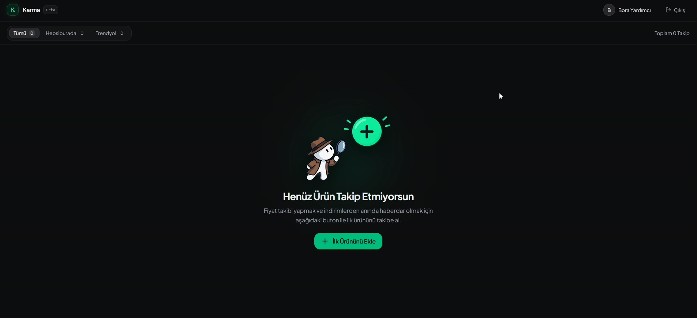
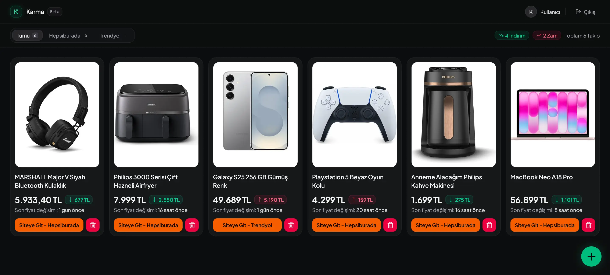
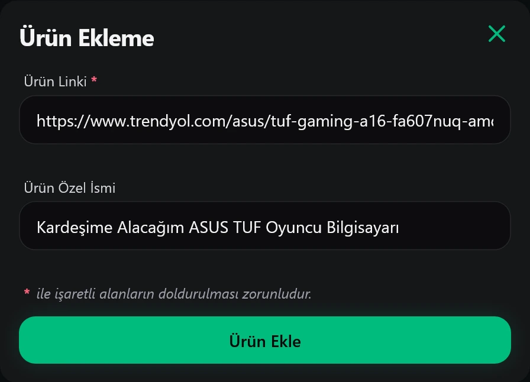
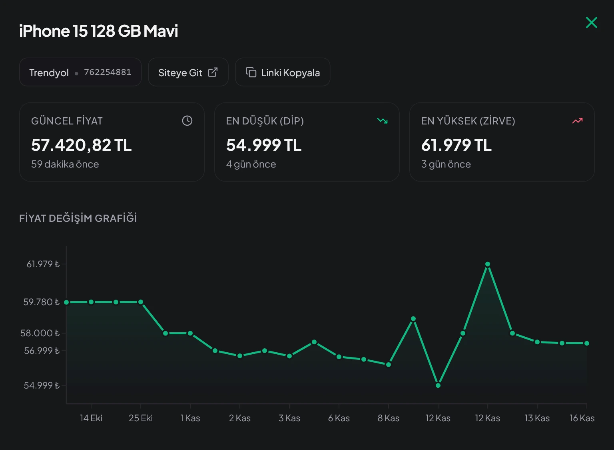
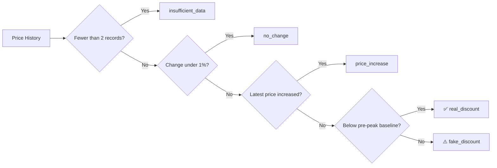
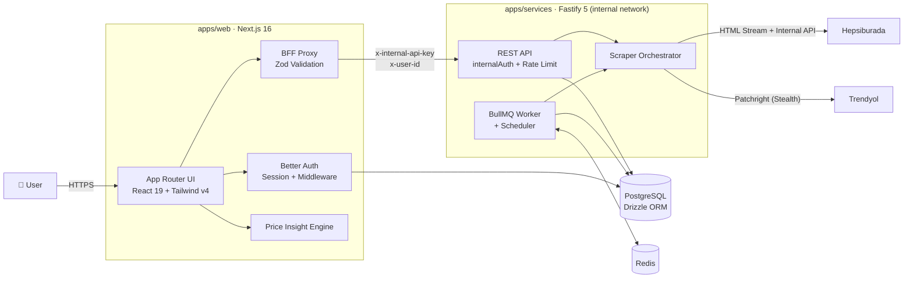
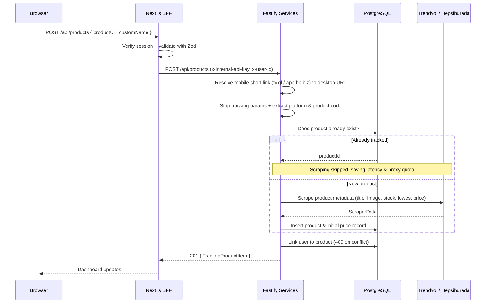
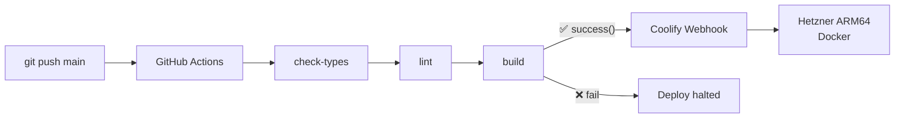

<p align="center">
  <strong>🇬🇧 English</strong> &nbsp;|&nbsp; <a href="./README.tr.md">🇹🇷 Türkçe</a>
</p>

<div align="center">


# Karma

### Is that discount real, or was the price inflated first?

**Track Trendyol and Hepsiburada products in a single dashboard; visualize price history and catch fake discounts.**

<a href="https://karmatakip.com"><strong>🌐 Live Demo: karmatakip.com</strong></a>
&nbsp;·&nbsp;
<a href="#-features">Features</a>
&nbsp;·&nbsp;
<a href="#-system-architecture">Architecture</a>
&nbsp;·&nbsp;
<a href="#-engineering-details">Engineering</a>
&nbsp;·&nbsp;
<a href="#-local-setup">Setup</a>

<br />

[](https://github.com/borayrdmc/Karma/actions/workflows/ci.yml)


<br />



</div>

---

## 💡 Why Karma?

A common pattern during Turkish e-commerce sales: a product's price is **inflated** a few days before a campaign, then dropped back to **its original price (or slightly below)** under a "30% OFF" badge. Telling genuine discounts apart from artificial ones requires seeing the product's actual price history.

**Karma** solves this end-to-end:

1. 🔗 Paste any product URL (Trendyol or Hepsiburada — desktop links or `ty.gl` / `app.hb.biz` mobile share links).
2. ⏱️ Karma automatically checks price and stock availability **every 4 hours** in the background.
3. 📈 Interactive charts plot historical price trends, highlighting lowest and peak points.
4. 🧠 The **Price Insight** engine flags whether a discount is **genuine or artificial**.

<br />



---

## ✨ Features

<table>
  <tr>
    <td width="50%" valign="top">
      <h3>🔗 One-Click Product Tracking</h3>
      <p>Paste a desktop or mobile share link (<code>ty.gl</code>, <code>app.hb.biz</code>) and optionally assign a custom label like <em>"Coffee machine for mom"</em>. The platform and product code are extracted automatically.</p>
      
    </td>
    <td width="50%" valign="top">
      <h3>📈 Price History & Analytics</h3>
      <p>View current price, all-time low, peak price, and an interactive Recharts price-history graph for every tracked item.</p>
      
    </td>
  </tr>
</table>

| | Feature | Description |
|:-:|---|---|
| 🛒 | **Cross-Platform Watchlist** | Track Trendyol and Hepsiburada products in one unified dashboard with platform filtering |
| 📱 | **Mobile Short-Link Resolution** | Automatically resolves `ty.gl` and `app.hb.biz` mobile app share links |
| 🧠 | **Fake-Discount Detection** | 30-day rolling-window algorithm distinguishing real discounts from raise-then-discount hikes |
| 🏷️ | **Price Delta & Stock Tracking** | Displays latest price change (₺), time since last change, and real-time stock status |
| ⏰ | **Automated Background Updates** | BullMQ scheduled jobs refreshing prices and stock status every 4 hours |
| 🔐 | **Secure Authentication** | Session-based auth with Better Auth (email/password sign-in and email password reset) |
| 🎨 | **Polished UI** | Dark theme, GSAP animations, and custom illustrations for empty, error, and 404 states |

<div align="center">
  
  &nbsp;&nbsp;&nbsp;
  
  &nbsp;&nbsp;&nbsp;
  
  <br />
  <sub>Custom illustrations for empty, error, and 404 states</sub>
</div>

---

## 🧠 Price Insight: Fake-Discount Detection Engine

The core analytics engine of the platform. It evaluates the **30-day rolling window** (anchored by the latest pre-window baseline price) to determine whether a price drop is genuine. Fluctuations under 1% are filtered out as noise, and brief (<24h) temporary spikes returning to baseline are ignored.



| Status | Meaning |
|---|---|
| ✅ `real_discount` | Price dropped **below** the pre-peak baseline. A genuine deal. |
| ⚠️ `fake_discount` | Price dropped from a recent peak but remains **above the pre-peak baseline** (raise-then-discount). |
| 📈 `price_increase` | Price rose; calculates net increase amount and percentage from the baseline. |
| ➖ `no_change` | Price is unchanged or within the 1% noise threshold. |
| ⏳ `insufficient_data` | At least 2 price records are required for analysis. |

---

## 🏗 System Architecture

Karma is architected as a decoupled **pnpm + Turborepo monorepo**. The user-facing web application and the scraping worker server run in **completely isolated processes**. The worker service is unreachable from the public internet and only accepts requests from the Next.js BFF layer over the private Docker network.



### 📦 Monorepo Layout

```
Karma/
├── apps/
│   ├── web/                # Next.js 16: UI, Better Auth, BFF Proxy, Price Insight
│   └── services/           # Fastify 5: REST API, Scrapers, BullMQ Queue/Worker
└── packages/
    ├── db/                 # Drizzle schemas (Auth + Product), migrations, modular queries
    ├── errors/             # Centralized ServiceError class (statusCode + isFatal flag)
    ├── types/              # End-to-end shared TypeScript types
    ├── validations/        # Shared Zod schemas
    ├── utils/              # Platform-agnostic utilities
    ├── eslint-config/      # Shared ESLint presets
    └── typescript-config/  # Shared tsconfig presets
```

### 🔄 Product Tracking Flow (Smart Deduplication)



---

## 🔬 Engineering Details

### 🕷️ Scraping Pipeline, WAF Bypass & Mobile Link Resolution

| Component | Strategy |
|---|---|
| **Hepsiburada** | On initial tracking, extracts product title, image, and code from the HTML stream, then queries the undocumented internal listings API (`api/v1/product/listings/<code>`) to select the **cheapest seller listing**. Supports both standard (`-p-`) and marketplace (`-pm-`) URLs: codes starting with `HBCV`/`HBV` are used directly, while parent product codes fall back to `<meta name="page_value">` in the HTML. Scheduled 4-hour updates skip HTML completely and hit the JSON API directly. |
| **Trendyol** | Uses **`patchright`** (a stealth Playwright/Chromium fork that hides automation fingerprints, configured with `--headless=new`, `tr-TR` locale, and `Sec-Fetch-*` headers) to bypass WAF/bot protection. Parses `window["__envoy__SHARED_PROPS"]` from the HTML source to extract product metadata, stock availability, and the `winnerVariant` selling price. |
| **Mobile Short Links (`resolveLinkFormat`)** | Supports `ty.gl` (Trendyol) and `app.hb.biz` (Hepsiburada) share links safely. To prevent SSRF and open-redirect vulnerabilities, redirects are never followed blindly: `redirect: "manual"` steps through up to 5 hops, validating every intermediate host against an allowlist (`ty.gl`, `app.hb.biz`, `*.adj.st`). As soon as the target platform (`trendyol.com` / `hepsiburada.com`) is reached, `response.body?.cancel()` closes the socket without downloading the body and strips query parameters. |

All outbound scraping requests route through a Turkish **auto-rotating residential proxy pool** (`undici` `ProxyAgent` and Patchright proxy configuration).

### ⚡ Speed & Bandwidth Optimizations

Minimizing transferred bytes and blocking unnecessary subresources delivers two major wins: **significantly faster scraper response times** and dramatic savings on per-GB residential proxy traffic:

| Optimization | Technique | Payload | Impact |
|---|---|---|:-:|
| **Stream Early-Cutoff** (Hepsiburada) | Streams the HTTP response via `response.body.getReader()` instead of buffering the full page; cancels the socket (`reader.cancel()`) the moment `<head>` / `utagData` is parsed, skipping the remaining ~900 KB body. | 1,036 KB → 127 KB | **88%** less data & faster responses |
| **Document-Only Intercept** (Trendyol) | Uses Patchright `page.route('**/*')` to allow only the main `document` request, immediately calling `abort()` on images, CSS, fonts, media, and external scripts while waiting only for `domcontentloaded`. | ~8 MB → ~200 KB | **97%** less data & much faster scraping |

### 🔁 Fault-Tolerant Background Jobs & Error Handling (Redis + BullMQ)

- **Producer/Consumer architecture:** Every 4 hours, the scheduler enqueues **isolated per-product jobs** via `addBulk`, so a single failing product never blocks the rest of the batch.
- **Rate limiting:** Worker runs at `concurrency: 1` with a `1 req / 2s` rate limiter to avoid hammering target platforms.
- **Centralized `ServiceError` & `isFatal` classification:** Errors across the monorepo are standardized with `ServiceError(message, statusCode, isFatal)` in `@repo/errors`. When a job fails, the worker inspects `error.isFatal`: fatal errors immediately throw BullMQ's `UnrecoverableError`, while transient errors retry with **exponential backoff + jitter**:
  - **`429 Too Many Requests` → Retried (`isFatal: false`):** Typically caused by a low-reputation rotated proxy IP; subsequent retries succeed on a fresh residential IP.
  - **`403 Forbidden` → Not retried (`isFatal: true`):** Indicates a scraper header/fingerprint issue rather than transient network flakiness; stops immediately instead of wasting quota.
  - **`404 Not Found` / Removed Listing → Not retried (`isFatal: true`):** Terminates immediately when a product page no longer exists or its schema changed.
- **Stock tracking (`inStock`):** Out-of-stock states (no active Hepsiburada listings or missing Trendyol `winnerVariant`) are **not treated as errors**. The product's `inStock` flag is set to `false` and continues to be checked every 4 hours so restocks are detected automatically.
- **Delta-only writes:** New price records are inserted only when the price actually changes from the last stored value.
- **Automated garbage collection:** Every Sunday at 03:00, products no longer tracked by any user are purged from PostgreSQL.

### 🔐 Security

- **BFF (Backend-for-Frontend) pattern:** The browser never communicates with the worker service directly. User identity is derived strictly from the server-side **session**, never trusted from client payloads.
- **Network-isolated backend:** The Fastify service is inaccessible from the public internet and only accepts internal Docker network calls authenticated by the `internalAuth` plugin (`x-internal-api-key`).
- **Layered validation:** Route protection via Next.js middleware, request validation via Zod, and rate limiting via `@fastify/rate-limit`.
- **Centralized error handling:** Unified `ServiceError` and Fastify `setErrorHandler` prevent internal stack traces from leaking to clients.
- **Database integrity:** Composite unique constraints on `(platform, productCode)` and `(userId, productId)`, cascading deletes, and a composite index on `(productId, checkedAt)`.

### 🚀 CI/CD & Production Infrastructure



- **CI-gated deployment:** Coolify runs in `Manual deployments only` mode. Deployment webhooks fire **only** when type-checking, linting, and production builds all pass in GitHub Actions — broken code never reaches production.
- **Infrastructure:** Docker containers orchestrated with Coolify v4 on a Hetzner CAX11 (ARM64) VPS, Traefik + Let's Encrypt SSL, Cloudflare DNS, and Supabase PostgreSQL.
- **Observability:** Sentry (client, server, and edge runtimes; release health), 24/7 uptime monitoring via UptimeRobot, and automated CVE scanning via GitHub Dependabot.

---

## 🧰 Tech Stack

| Layer | Technologies |
|---|---|
| **Language** | TypeScript (end-to-end type safety) |
| **Frontend** | Next.js 16 (App Router, Server Components, Route Handlers), React 19, Tailwind CSS v4, shadcn/ui, Radix UI, Recharts, GSAP |
| **Authentication** | Better Auth (Drizzle adapter), Resend (password reset emails) |
| **Backend** | Fastify 5, fastify-plugin, @fastify/rate-limit |
| **Database** | PostgreSQL, Drizzle ORM, drizzle-kit |
| **Queue** | Redis, BullMQ, ioredis |
| **Scraping** | Patchright (stealth Playwright), undici, residential proxy |
| **Validation** | Zod |
| **Monorepo** | pnpm workspaces, Turborepo |
| **DevOps** | GitHub Actions, Docker, Coolify, Hetzner, Cloudflare |
| **Monitoring** | Sentry, UptimeRobot, Dependabot |

---

## 🛠 Local Setup

### 🐳 Option 1: One-Command Docker Compose (Recommended)

Spin up the entire stack (Next.js, Fastify, Worker, PostgreSQL, and Redis) on an isolated network without installing Node.js, PostgreSQL, or Redis locally:

```bash
# Clone and start
git clone https://github.com/borayrdmc/Karma.git
cd Karma
docker compose up --build
```

Once containers are ready, open **http://localhost:3000**.

---

### 💻 Option 2: Manual Development Setup

#### Prerequisites

- **Node.js** ≥ 22
- **pnpm** 9
- **PostgreSQL** (local or Supabase/Neon)
- **Redis** (e.g. via Docker)

#### Steps

```bash
# 1. Clone the repository
git clone https://github.com/borayrdmc/Karma.git
cd Karma

# 2. Install dependencies
pnpm install

# 3. Configure environment variables
cp apps/web/.env.example apps/web/.env
cp apps/services/.env.example apps/services/.env
cp packages/db/.env.example packages/db/.env

# 4. Start Redis
docker run -d --name karma-redis -p 6379:6379 redis:7-alpine

# 5. Run database migrations
pnpm --filter @repo/db db:migrate

# 6. Install Chromium for Patchright
pnpm --filter services exec patchright install chromium

# 7. Start all apps in development mode
pnpm dev
```

| App | URL |
|---|---|
| Web (Next.js) | http://localhost:3000 |
| Services (Fastify) | http://localhost:3001 |

### Key Environment Variables

| Variable | Location | Description |
|---|---|---|
| `DATABASE_URL` | web, services, db | PostgreSQL connection string |
| `INTERNAL_API_KEY` | web, services | Shared secret between web and services (**must match on both**) |
| `BETTER_AUTH_SECRET` | web | Session signing secret (`openssl rand -base64 32`) |
| `SERVICES_URL` | web | Fastify server URL |
| `REDIS_URL` | services | Redis connection URL for BullMQ |
| `PROXY_URL` | services | *(Optional)* Residential proxy URL |
| `RESEND_API_KEY` | web | *(Optional)* Password reset emails |
| `NEXT_PUBLIC_SENTRY_DSN` | web | *(Optional)* Sentry error tracking |

### Useful Commands

```bash
pnpm build          # Build all packages (with Turborepo cache)
pnpm lint           # Run ESLint checks
pnpm check-types    # TypeScript type-checking across the monorepo
pnpm format         # Format with Prettier
```

---

## 🗺 Roadmap

- [x] Trendyol and Hepsiburada support
- [x] Mobile short-link (`ty.gl` & `app.hb.biz`) resolution
- [x] Price Insight: fake-discount detection
- [x] Automated price & stock updates (BullMQ)
- [x] Better Auth user system & password reset
- [x] CI-gated production deployment
- [ ] Target price alerts (email / push notifications)
- [ ] Amazon & N11 support
- [ ] Cross-platform comparison for the same product
- [ ] Browser extension for one-click tracking

---

<div align="center">

Try it live at **[karmatakip.com](https://karmatakip.com)**.

Built by [@borayrdmc](https://github.com/borayrdmc).

<sub>If you like this project, consider giving it a ⭐!</sub>

</div>
